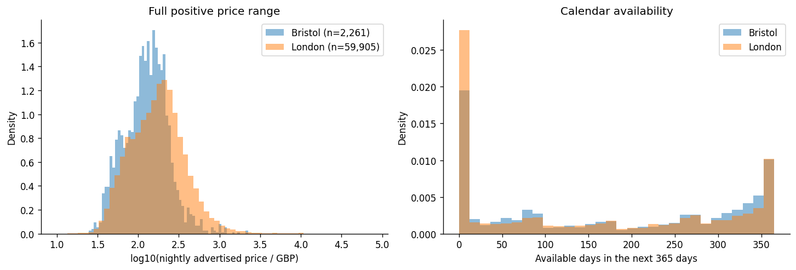
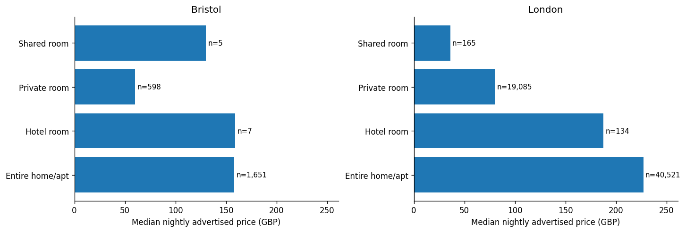

# London and Bristol: EDA findings

Execution completed: 2026-11-09T11:03:54.437710+00:00. Python 3.11.10; pandas 1.5.3; NumPy 1.23.5.

## Findings and limitations

London has 91,954 rows and Bristol 2,932; median positive prices are £175.00 and £130.00.

The tables below describe all A/B snapshot rows and positive parsed prices. No raw rows were removed or overwritten. Prices are advertised nightly amounts in GBP, not realised booking revenue. City snapshots differ by five days. Model error and transfer performance remain unmeasured.

## Dataset provenance and grain

| city | snapshot_date | rows | source_columns | loaded_columns | sha256_verified | source_url |
| --- | --- | --- | --- | --- | --- | --- |
| london | 2026-09-17 | 91954 | 90 | 39 | True | https://data.insideairbnb.com/united-kingdom/england/london/2026-09-17/data/listings.csv.gz |
| bristol | 2026-09-22 | 2932 | 90 | 39 | True | https://data.insideairbnb.com/united-kingdom/england/bristol/2026-09-22/data/listings.csv.gz |

| city | rows | missing_id | duplicate_key_rows | scrape_date_differs_from_snapshot_label |
| --- | --- | --- | --- | --- |
| bristol | 2932 | 0 | 0 | 2932 |
| london | 91954 | 0 | 0 | 91954 |

| city | last_scraped | rows |
| --- | --- | --- |
| bristol | 2026-09-25 | 2932 |
| london | 2026-09-18 | 18975 |
| london | 2026-09-19 | 22635 |
| london | 2026-09-20 | 15121 |
| london | 2026-09-21 | 17477 |
| london | 2026-09-22 | 12683 |
| london | 2026-09-23 | 5063 |

Published snapshot labels and actual listing scrape dates differ. Preserve both; do not treat the difference alone as a corrupt record.

## Price distribution (GBP)

| city | count | mean | median | min | max | p25 | p75 | p95 | p99 | upper_iqr_fence | above_iqr_rows |
| --- | --- | --- | --- | --- | --- | --- | --- | --- | --- | --- | --- |
| bristol | 2261 | 157.22 | 130.0 | 24.6 | 2238.0 | 83.0 | 189.5 | 335.0 | 689.13 | 349.25 | 103 |
| london | 59905 | 248.35 | 175.0 | 10.0 | 75000.0 | 99.67 | 279.75 | 604.99 | 1272.16 | 549.87 | 3754 |

Positive parsed targets form the denominator for price statistics. Quality flags below cover all source rows.

## Quality flags and cleaning impact

| city | rule | affected_rows | pct |
| --- | --- | --- | --- |
| bristol | missing_price | 671 | 22.89 |
| bristol | malformed_price | 0 | 0.0 |
| bristol | zero_price | 0 | 0.0 |
| bristol | negative_price | 0 | 0.0 |
| bristol | price_below_10 | 0 | 0.0 |
| bristol | price_above_2000 | 2 | 0.07 |
| bristol | missing_id | 0 | 0.0 |
| bristol | duplicate_key | 0 | 0.0 |
| bristol | nonpositive_or_fractional_accommodates | 0 | 0.0 |
| bristol | availability_30_invalid | 0 | 0.0 |
| bristol | availability_60_invalid | 0 | 0.0 |
| bristol | availability_90_invalid | 0 | 0.0 |
| bristol | availability_365_invalid | 0 | 0.0 |
| bristol | availability_nonmonotonic | 0 | 0.0 |
| bristol | bathrooms_negative | 0 | 0.0 |
| bristol | bedrooms_negative | 0 | 0.0 |
| bristol | beds_negative | 0 | 0.0 |
| bristol | number_of_reviews_negative | 0 | 0.0 |
| bristol | rating_outside_0_5 | 0 | 0.0 |
| bristol | upper_iqr_review_only | 103 | 3.51 |
| london | missing_price | 32049 | 34.85 |
| london | malformed_price | 0 | 0.0 |
| london | zero_price | 0 | 0.0 |
| london | negative_price | 0 | 0.0 |
| london | price_below_10 | 0 | 0.0 |
| london | price_above_2000 | 270 | 0.29 |
| london | missing_id | 0 | 0.0 |
| london | duplicate_key | 0 | 0.0 |
| london | nonpositive_or_fractional_accommodates | 0 | 0.0 |
| london | availability_30_invalid | 0 | 0.0 |
| london | availability_60_invalid | 0 | 0.0 |
| london | availability_90_invalid | 0 | 0.0 |
| london | availability_365_invalid | 0 | 0.0 |
| london | availability_nonmonotonic | 0 | 0.0 |
| london | bathrooms_negative | 0 | 0.0 |
| london | bedrooms_negative | 0 | 0.0 |
| london | beds_negative | 0 | 0.0 |
| london | number_of_reviews_negative | 0 | 0.0 |
| london | rating_outside_0_5 | 0 | 0.0 |
| london | upper_iqr_review_only | 3754 | 4.08 |

Flag counts overlap and must not be summed into a deletion count. Values below £10 or above £2,000 and upper-IQR flags require review rather than automatic exclusion.

## Column profile

The complete used-column schema and missingness audit is in [eda_profile.md](eda_profile.md).

## Missingness patterns

| missing_columns | rows | city | pct |
| --- | --- | --- | --- |
| bathrooms, neighbourhood_group_cleansed | 2012 | bristol | 68.62 |
| price, bathrooms, neighbourhood_group_cleansed | 584 | bristol | 19.92 |
| bathrooms, review_scores_rating, reviews_per_month, neighbourhood_group_cleansed | 207 | bristol | 7.06 |
| price, bathrooms, review_scores_rating, reviews_per_month, neighbourhood_group_cleansed | 72 | bristol | 2.46 |
| bathrooms, beds, neighbourhood_group_cleansed | 32 | bristol | 1.09 |
| bathrooms, neighbourhood_group_cleansed | 46471 | london | 50.54 |
| price, bathrooms, neighbourhood_group_cleansed | 23297 | london | 25.34 |
| bathrooms, review_scores_rating, reviews_per_month, neighbourhood_group_cleansed | 11908 | london | 12.95 |
| price, bathrooms, review_scores_rating, reviews_per_month, neighbourhood_group_cleansed | 8246 | london | 8.97 |
| bathrooms, beds, neighbourhood_group_cleansed | 1156 | london | 1.26 |

Pattern percentages use all rows in each city. Complete rows are included; combinations identify jointly absent fields.

## Review-history missingness

| city | has_reviews | rows | missing_rating_pct |
| --- | --- | --- | --- |
| bristol | False | 288 | 100.0 |
| bristol | True | 2644 | 0.0 |
| london | False | 20694 | 100.0 |
| london | True | 71260 | 0.0 |

Missing ratings among rows without reviews are structurally plausible; unexplained gaps among reviewed listings require checking. Do not fabricate ratings.

## Price missingness by availability

| city | availability_group | zero_available_days | rows | missing_price_pct |
| --- | --- | --- | --- | --- |
| bristol | missing | False | 12 | 100.0 |
| bristol | missing | True | 6 | 100.0 |
| bristol | t | False | 2329 | 2.96 |
| bristol | t | True | 585 | 99.83 |
| london | f | False | 55 | 21.82 |
| london | f | True | 310 | 4.19 |
| london | missing | False | 522 | 99.43 |
| london | missing | True | 239 | 100.0 |
| london | t | False | 63095 | 5.61 |
| london | t | True | 27733 | 99.97 |

This association does not identify the cause of missing prices. Do not infer occupancy from unavailable days or impute target prices from quote fields.

## Bathroom recovery audit

| city | numeric_missing | text_present | recoverable_from_text | unrecognised_text |
| --- | --- | --- | --- | --- |
| bristol | 2932 | 2930 | 2930 | 0 |
| london | 91954 | 91846 | 91836 | 10 |

## Numeric parse failures

| city | column | parse_failures |
| --- | --- | --- |

## City comparisons

### Calendar availability in the next 365 days (days)

| city | count | mean | median | min | max |
| --- | --- | --- | --- | --- | --- |
| bristol | 2932 | 176.61 | 173.0 | 0.0 | 365.0 |
| london | 91954 | 153.19 | 120.0 | 0.0 | 365.0 |

### Review rating (0–5)

| city | count | mean | median |
| --- | --- | --- | --- |
| bristol | 2644 | 4.76 | 4.87 |
| london | 71260 | 4.69 | 4.83 |

### Room-type composition

| city | room_type | rows | pct |
| --- | --- | --- | --- |
| bristol | Entire home/apt | 2113 | 72.07 |
| bristol | Hotel room | 7 | 0.24 |
| bristol | Private room | 807 | 27.52 |
| bristol | Shared room | 5 | 0.17 |
| london | Entire home/apt | 61074 | 66.42 |
| london | Hotel room | 207 | 0.23 |
| london | Private room | 30471 | 33.14 |
| london | Shared room | 202 | 0.22 |

Availability is calendar availability, not occupancy. Review aggregates exclude missing scores and report their non-null denominator.

## Segment prices (GBP)

### room_type

| city | room_type | priced_rows | median_gbp | mean_gbp |
| --- | --- | --- | --- | --- |
| bristol | Entire home/apt | 1651 | 158.0 | 189.48 |
| bristol | Hotel room | 7 | 159.0 | 160.07 |
| bristol | Private room | 598 | 60.0 | 68.27 |
| bristol | Shared room | 5 | 130.0 | 139.0 |
| london | Entire home/apt | 40521 | 227.0 | 308.5 |
| london | Hotel room | 134 | 187.5 | 263.24 |
| london | Private room | 19085 | 80.0 | 122.05 |
| london | Shared room | 165 | 36.0 | 74.32 |

### accommodates

| city | accommodates | priced_rows | median_gbp | mean_gbp |
| --- | --- | --- | --- | --- |
| bristol | 1.0 | 222 | 50.0 | 62.05 |
| bristol | 2.0 | 861 | 95.0 | 101.5 |
| bristol | 3.0 | 98 | 117.25 | 125.89 |
| bristol | 4.0 | 465 | 156.0 | 166.6 |
| bristol | 5.0 | 103 | 170.0 | 217.58 |
| bristol | 6.0 | 247 | 198.5 | 212.67 |
| bristol | 7.0 | 52 | 221.0 | 245.28 |
| bristol | 8.0 | 89 | 248.33 | 302.0 |
| bristol | 9.0 | 31 | 280.8 | 315.6 |
| bristol | 10.0 | 43 | 240.0 | 328.38 |
| bristol | 11.0 | 14 | 267.57 | 308.57 |
| bristol | 12.0 | 16 | 358.5 | 378.37 |
| bristol | 13.0 | 3 | 351.0 | 538.33 |
| bristol | 14.0 | 5 | 343.0 | 349.3 |
| bristol | 15.0 | 1 | 1746.5 | 1746.5 |
| bristol | 16.0 | 11 | 945.0 | 958.31 |
| london | 1.0 | 6177 | 65.0 | 102.36 |
| london | 2.0 | 21592 | 118.0 | 164.45 |
| london | 3.0 | 4724 | 161.64 | 214.25 |
| london | 4.0 | 12414 | 223.64 | 274.6 |
| london | 5.0 | 3724 | 248.9 | 302.5 |
| london | 6.0 | 6072 | 305.0 | 387.24 |
| london | 7.0 | 1267 | 308.69 | 372.24 |
| london | 8.0 | 2087 | 368.0 | 511.86 |
| london | 9.0 | 444 | 332.0 | 429.61 |
| london | 10.0 | 717 | 429.0 | 636.2 |
| london | 11.0 | 127 | 381.75 | 521.1 |
| london | 12.0 | 244 | 490.5 | 841.96 |
| london | 13.0 | 59 | 425.6 | 555.54 |
| london | 14.0 | 82 | 443.75 | 825.92 |
| london | 15.0 | 32 | 337.17 | 459.55 |
| london | 16.0 | 143 | 815.0 | 1553.74 |

### neighbourhood_cleansed

| city | neighbourhood_cleansed | priced_rows | median_gbp | mean_gbp |
| --- | --- | --- | --- | --- |
| bristol | Ashley | 231 | 124.67 | 149.77 |
| bristol | Central | 202 | 132.85 | 155.13 |
| bristol | Clifton | 159 | 157.0 | 183.89 |
| bristol | Clifton Down | 153 | 160.0 | 193.13 |
| bristol | Southville | 115 | 127.0 | 142.63 |
| bristol | Cotham | 102 | 121.25 | 168.03 |
| bristol | Hotwells & Harbourside | 98 | 150.5 | 208.96 |
| bristol | Lawrence Hill | 98 | 139.41 | 150.52 |
| bristol | Easton | 83 | 109.0 | 118.44 |
| bristol | Windmill Hill | 75 | 131.5 | 149.81 |
| london | Westminster | 7960 | 282.0 | 414.9 |
| london | Kensington and Chelsea | 4652 | 273.18 | 393.88 |
| london | Camden | 4293 | 207.67 | 266.72 |
| london | Tower Hamlets | 3879 | 161.5 | 210.47 |
| london | Southwark | 3033 | 158.0 | 213.19 |
| london | Lambeth | 2837 | 153.2 | 249.93 |
| london | Hackney | 2828 | 164.46 | 201.19 |
| london | Wandsworth | 2694 | 185.21 | 248.5 |
| london | Hammersmith and Fulham | 2682 | 184.0 | 244.49 |
| london | Islington | 2498 | 182.0 | 236.01 |

## Leakage audit

| column | decision | reason |
| --- | --- | --- |
| price | exclude | Target |
| price_quote_checkin_date | exclude | Price quotation or quotation metadata |
| price_quote_checkout_date | exclude | Price quotation or quotation metadata |
| price_quote_total_price | exclude | Price quotation or quotation metadata |
| price_quote_price_per_night | exclude | Price quotation or quotation metadata |
| price_quote_raw | exclude | Price quotation or quotation metadata |
| estimated_occupancy_l365d | exclude | Estimation assumptions and demand endogeneity |
| estimated_revenue_l365d | exclude | Monetary estimate may directly encode target price |
| review_scores_value | exclude | Value judgement depends on advertised price |

| city | column | paired_rows | pearson_with_price | equal_to_price_rows |
| --- | --- | --- | --- | --- |
| bristol | estimated_revenue_l365d | 2261 | 0.3327 | 0 |
| bristol | price_quote_total_price | 2261 | 0.2639 | 812 |
| bristol | price_quote_price_per_night | 2261 | 1.0 | 2261 |
| london | estimated_revenue_l365d | 59905 | 0.157 | 0 |
| london | price_quote_total_price | 59761 | 0.3279 | 21470 |
| london | price_quote_price_per_night | 59761 | 1.0 | 59761 |

| city | paired_rows | pearson_with_price | equal_within_1p_rows |
| --- | --- | --- | --- |
| bristol | 1827 | 1.0 | 1787 |
| london | 40129 | 1.0 | 37629 |

Exclude all price quotations, quotation metadata, revenue estimates, perceived-value scores and price-derived features. Correlation is diagnostic and is not evidence that an unflagged field is safe. Revenue/occupancy ratios are prohibited features.

## Verified leakage findings

The per-night quotation equals the target on every paired row in both cities. Revenue divided by estimated occupied days is also an almost exact price proxy. Neither belongs in the predictor set.

## ETL recommendations

Retain immutable Bronze files and provenance. In Silver, preserve rows with quality flags, quarantine invalid keys, parse GBP explicitly, retain missing values, and distinguish malformed from absent values. Exclude invalid targets only from supervised targets; keep their records for inference where possible. Review extremes without automatic capping. Validate capacity, availability and score domains. See cleaning_specification.md for rule rationales.

## ML handoff

Begin with room_type, property_type, accommodates, bedrooms, beds, bathrooms, latitude, longitude, minimum_nights and maximum_nights. Omit instant_bookable and neighbourhood_group_cleansed because both are entirely missing in the pinned snapshots; derive bathroom counts from text. Missing attributes need train-only imputation and indicators. City and neighbourhood require a pre-specified unseen-category policy. Reserve a test set per city before model selection; fit preprocessing, thresholds and baseline medians on training data only. No EDA summary is a test-set model metric.

## Unresolved questions

The publisher confirms that price uses local currency and that the dollar sign is an export artifact. Confirm newer quotation and revenue-estimation semantics against publisher metadata. Resolve structural missingness before selecting optional features. Production ETL, model evaluation and geographic transfer performance remain outside the scope of this exploratory analysis.

## Figures

## Source

[Inside Airbnb data downloads](https://insideairbnb.com/get-the-data/), CC BY 4.0. Snapshot URLs and checksums are recorded in sources.json.
