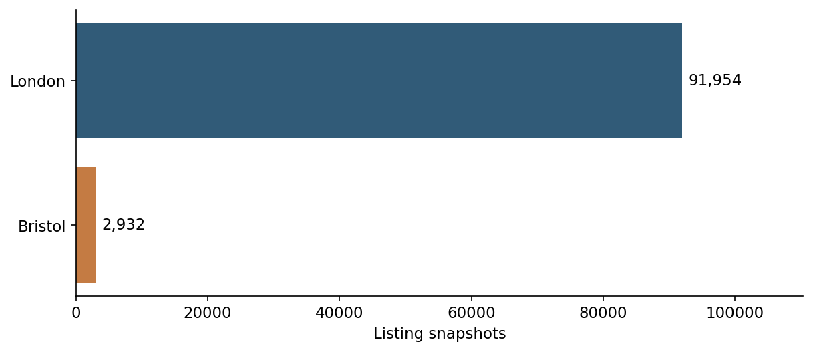
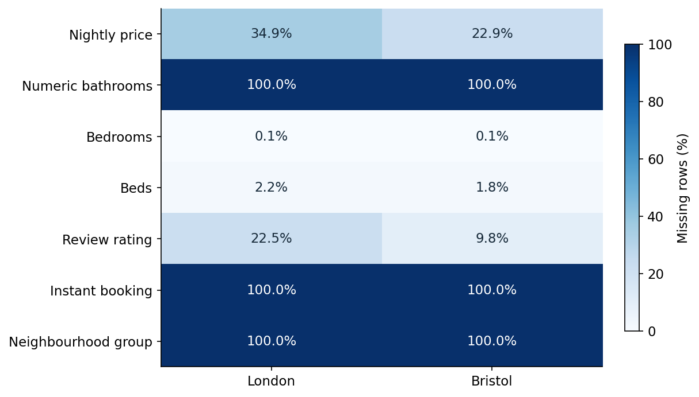
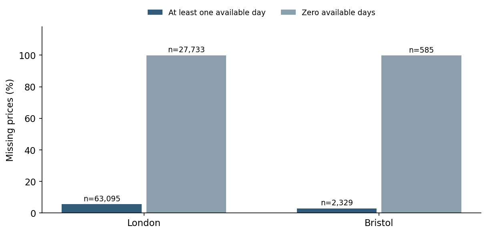
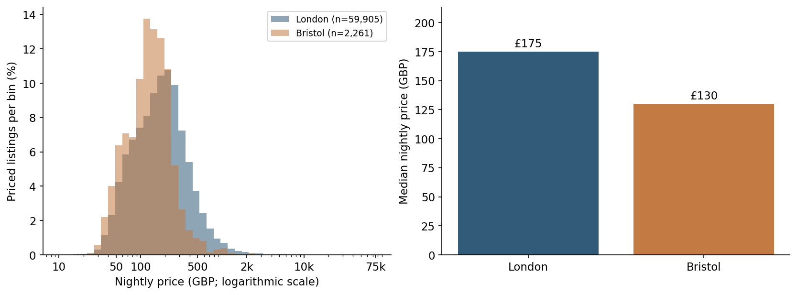
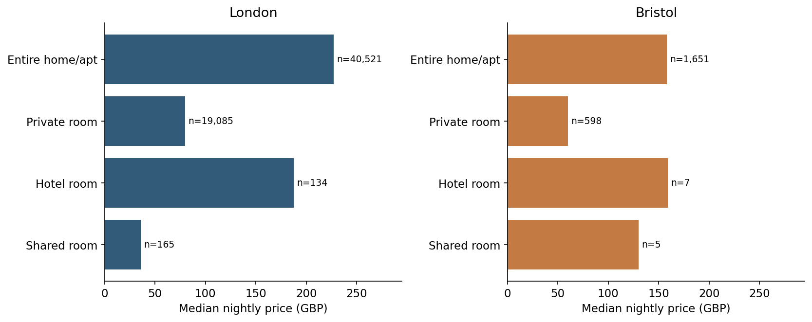
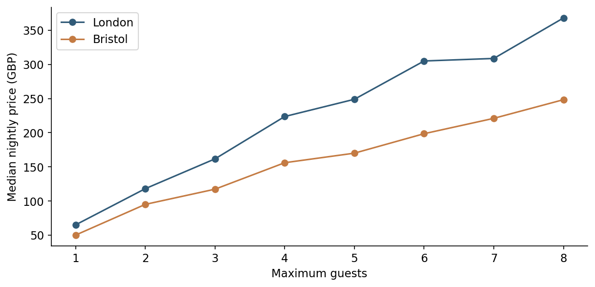
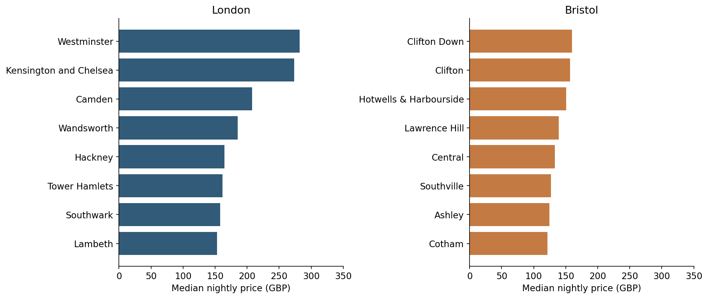
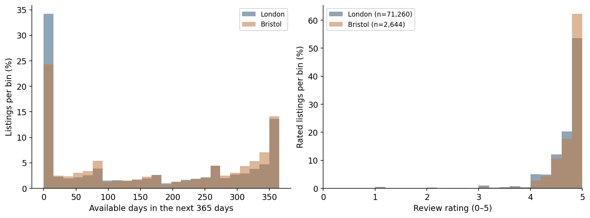
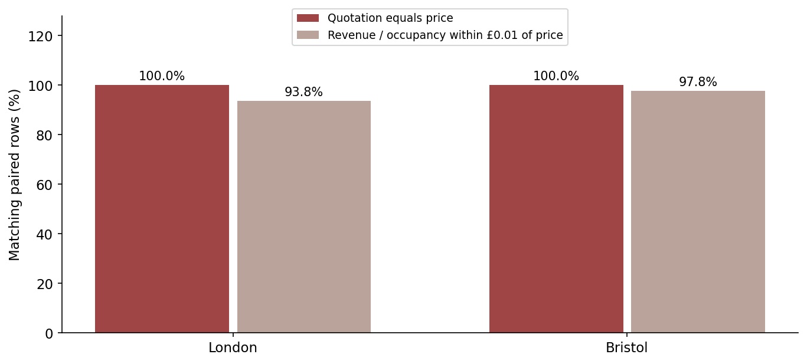

# London and Bristol: exploratory analysis

Execution: 2026-11-09T11:14:24.724779+00:00. Prices are nightly advertised GBP amounts. One row is one listing snapshot.

## Summary

London has higher observed advertised prices than Bristol. Missing targets and empty fields require explicit handling. Price quotations and revenue-derived fields must be excluded from predictors. Missing-price causes, extreme-price validity and out-of-city performance remain unresolved.

## Dataset and provenance

| city | snapshot_date | rows | source_columns | loaded_columns | sha256_verified | source_url |
| --- | --- | --- | --- | --- | --- | --- |
| london | 2026-09-17 | 91954 | 90 | 39 | True | https://data.insideairbnb.com/united-kingdom/england/london/2026-09-17/data/listings.csv.gz |
| bristol | 2026-09-22 | 2932 | 90 | 39 | True | https://data.insideairbnb.com/united-kingdom/england/bristol/2026-09-22/data/listings.csv.gz |

### London contributes most listing snapshots

London contains **91,954** listings and Bristol **2,932**. Combined summaries are therefore dominated by London; city comparisons are reported separately.

### Missingness differs substantially by field

Price is missing for **34.85%** of London rows and **22.89%** of Bristol rows. Numeric bathrooms, instant booking and neighbourhood-group labels are entirely missing in both snapshots. Bathroom text permits recovery of **91,836** London and **2,930** Bristol counts.

### Missing prices are associated with calendar availability

Among listings marked as having availability, nearly all rows with zero available days lack a price. Missing prices are much less common when at least one day is available. This association does not establish the cause; observed-price summaries may describe a selected subset of listings.

### London has a higher median advertised price

The median is **£175** in London and **£130** in Bristol. The logarithmic axis preserves the full positive price range. Higher means than medians indicate a long upper tail; the city difference is descriptive rather than an adjusted city effect.

| city | count | mean | median | min | max |
| --- | --- | --- | --- | --- | --- |
| bristol | 2261 | 157.22 | 130.0 | 24.6 | 2238.0 |
| london | 59905 | 248.35 | 175.0 | 10.0 | 75000.0 |

**Extreme-value review.** Prices above £2,000 occur in **270** London and **2** Bristol records. The maximum is **£75,000**. These are review flags, not confirmed errors; no automatic trimming or capping is applied. No observed price is malformed, zero or negative in the pinned snapshots.

### Room type separates different price segments

Entire homes have higher median prices than private rooms in both cities. Compare the same room type across cities before interpreting an overall price difference. Hotel and shared-room estimates have small denominators, especially in Bristol.

### Larger guest capacity is associated with higher median prices

Median prices generally increase with guest capacity. The chart shows capacities of one to eight guests for readability; all capacities and segment counts remain in the technical audit. This association does not imply a causal effect.

### Prices vary within each city

Neighbourhood medians vary substantially within each city. The chart includes eight neighbourhoods with the most observed prices per city, not the eight most expensive. Differences also reflect property and room-type composition.

### Availability differs while observed review ratings are generally high

Median calendar availability is **120 days** in London and **173 days** in Bristol. Mean observed ratings are **4.69** and **4.76**. Missing overall ratings occur among listings with no recorded reviews; calendar availability must not be interpreted as occupancy.

### Quotation and revenue-derived fields reveal the target

The per-night quotation equals the target on every paired row. Revenue divided by estimated occupied days also closely reconstructs price. Exclude every `price_quote_*` field, revenue estimates and derived ratios; strong apparent predictive performance from these fields would be misleading.

| city | quotation_pairs | revenue_occupancy_pairs |
| --- | --- | --- |
| london | 59761 | 40129 |
| bristol | 2261 | 1827 |

## Cleaning and modelling implications

Preserve raw records and quality flags. Retain missing targets without replacing them with zero; exclude them only from supervised evaluation. Recover bathrooms from text. Omit entirely missing attributes from the initial model. Review extreme positive prices without automatic capping. Exclude quotation/revenue-derived predictors. Fit preprocessing and baseline statistics on training data only, after reserving the test set.

## Limitations

Published snapshot labels differ by five days and do not equal every listing scrape date. Comparisons are descriptive, price summaries use observed positive targets, small segments are unstable, and calendar availability is not occupancy. No model error or third-city transfer result has been measured.

## Technical evidence

[Full audit tables](eda_audit.md), [used-column profile](eda_profile.md), [cleaning specification](cleaning_specification.md). Source dates, URLs and SHA-256 checksums are recorded in sources.json. Inside Airbnb data are licensed CC BY 4.0.
