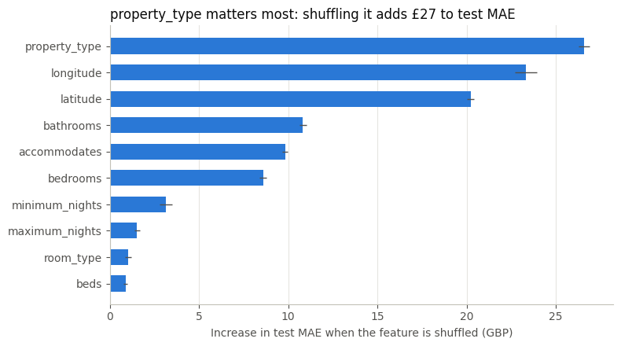

# London and Bristol: price model results

Execution: 2026-11-11T17:36:07Z, Databricks, model version `v1`. Prices are nightly advertised GBP amounts. One row is one listing snapshot.

## Summary

The selected gradient boosting model lowers test MAE from **£104.17** (baseline) to **£76.93** across London and Bristol, **26.1%** lower. Median absolute error falls from **£44.84** to **£32.31**. The gain is larger in Bristol (42.7%) than in London (25.7%). Property type and location drive the model most. The largest errors come from a small number of London listings advertised at about £5,000 or £10,000 a night. Performance on Greater Manchester has not been measured.

## Model

| Item | Value |
| --- | --- |
| Target | `log1p(price_gbp)`; predictions are returned in GBP with `expm1` |
| Model | Histogram gradient boosting, learning rate 0.05, 63 leaf nodes, early stopping, native categorical support |
| Selection | Lowest pooled 5-fold cross-validated MAE on training rows, among Ridge and four gradient boosting settings |
| Baseline | Training median price by `room_type` and `accommodates`; fallbacks: room-type median, then global median (£172) |
| Features (`v1`) | `room_type`, `property_type`, `accommodates`, `bedrooms`, `beds`, `bathrooms`, `latitude`, `longitude`, `minimum_nights`, `maximum_nights`; `city` is not a feature |
| Categories | Property types with fewer than 20 training rows, unseen values and missing values are grouped as `Other`; 36 property types and 4 room types are kept |
| Environment | Python 3.12.3, scikit-learn 1.7.2, pandas 2.3.3, NumPy 2.3.4 |
| Freeze package | `/Volumes/workspace/airbnb_eda/artifacts/models/v1/`; manifest without test metrics: [model_v1_manifest.json](model_v1_manifest.json) |

## Data and split

Each city is split separately: 20% of listings with a valid price form the test set, stratified by room type, seed 42. Listings without a valid price are labelled `inference`; they are scored but not evaluated.

| city | listings | valid prices | train | test | inference | test share |
| --- | --- | --- | --- | --- | --- | --- |
| bristol | 2,932 | 2,261 | 1,808 | 453 | 671 | 0.2004 |
| london | 91,954 | 59,905 | 47,924 | 11,981 | 32,049 | 0.2000 |

The 49,732 training rows are 96.4% London. Every training row matched a room-type and capacity group, so no baseline fallback was needed in training. Source files, checksums and the pipeline version are recorded in the manifest.

## Cross-validation

Out-of-fold MAE in GBP on training rows only; the test set was not used for model selection.

| candidate | bristol | london | combined |
| --- | --- | --- | --- |
| baseline | 69.90 | 111.76 | 110.24 |
| Ridge | 46.92 | 109.40 | 107.13 |
| **gradient boosting (selected)** | **41.20** | **85.70** | **84.08** |

The other three gradient boosting settings scored 84.16–84.73 combined. Ridge improves on the baseline in Bristol but only by 2.1% in London.

## Test results

The test set was evaluated once, after the model and baseline were fixed. Every test listing received a valid prediction from both predictors (coverage 100%). Combined values are weighted by listing count.

| city | test listings | baseline MAE | model MAE | change | baseline median AE | model median AE |
| --- | --- | --- | --- | --- | --- | --- |
| bristol | 453 | 69.69 | 39.95 | −42.7% | 45.50 | 19.71 |
| london | 11,981 | 105.47 | 78.33 | −25.7% | 44.84 | 32.88 |
| combined | 12,434 | 104.17 | 76.93 | −26.1% | 44.84 | 32.31 |

Test and cross-validation results agree: the model's combined MAE is £84.08 in cross-validation and £76.93 on the test set, and the ranking against the baseline is the same.

### MAE by room type

| room type | test listings | baseline MAE | model MAE |
| --- | --- | --- | --- |
| Entire home/apt | 8,435 | 131.70 | 95.05 |
| Private room | 3,937 | 45.85 | 38.74 |
| Shared room | 34 | 45.17 | 22.15 |
| Hotel room | 28 | 81.03 | 55.31 |

Entire homes have the largest errors in GBP because their prices are higher. Shared-room and hotel-room estimates rest on fewer than 40 listings each.

## Key findings

### Property type and location matter most

Shuffling `property_type` in the test set raises MAE by about **£27**, `longitude` by about **£23** and `latitude` by about **£20**. Bathrooms, capacity and bedrooms add about £9–11 each; minimum and maximum nights, room type and beds less than £4. Room type scores low because property type largely contains it (for example, "Private room in home"); permutation importance splits credit between correlated features. It describes what the model relies on, not causal effects.

### A few extreme London prices dominate the largest errors

All 20 largest test errors are London listings. Six are rental units for two to four guests advertised at **£9,925–£10,163** a night and predicted at £155–£861; six more are advertised at £5,000–£5,118. These round, repeated amounts are consistent with placeholder or availability-blocking prices rather than market rates, but this has not been verified, and the cleaning specification retains them.

These 20 listings, 0.17% of the London test set, account for about **13%** of London's total absolute error. Without them, London's model MAE would be about £68. Median absolute error is not affected by them and is the more robust summary.

## Limitations

- London provides 96.4% of training rows and dominates pooled results; Bristol results rest on 453 test listings.
- MAE is sensitive to the retained extreme prices; report median absolute error alongside it.
- 34.9% of London and 22.9% of Bristol listings have no valid price. They are scored but cannot be evaluated, and they may differ systematically: the EDA associates missing prices with zero calendar availability.
- The split is random by listing. Hosts with several similar listings can appear in both training and test sets, which may make test MAE optimistic.
- Location enters as raw coordinates learned in London and Bristol. Greater Manchester lies north of both, so these features cannot describe its neighbourhoods; transfer performance is untested.
- Prices are advertised nightly prices from one snapshot per city, not transaction prices, and do not capture seasonality.

## Technical evidence

[Model notebook](../notebooks/03_price_model.ipynb) (output-free in the repository), metrics in `workspace.airbnb_gold.model_metrics` (`model_version = 'v1'`, `dataset = 'development'`), [freeze manifest](model_v1_manifest.json), [data contract](data_contract.md), [cleaning specification](cleaning_specification.md).
